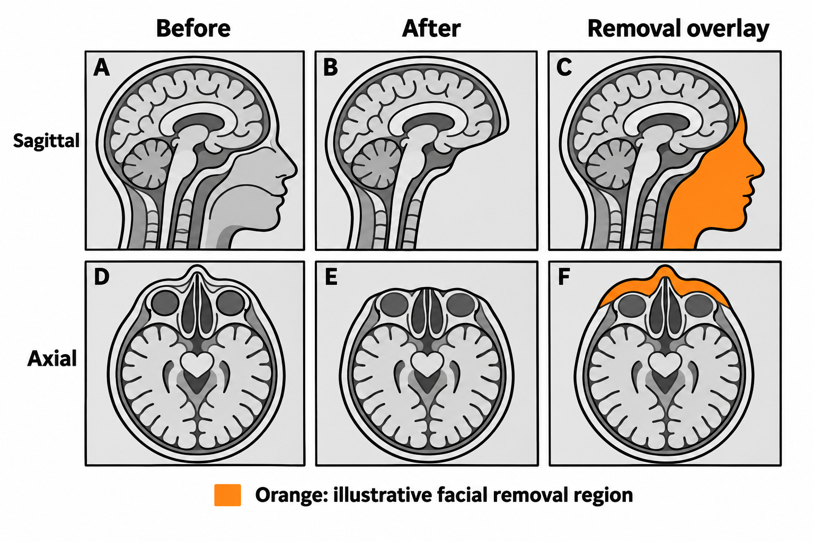

# Synthetic diagrams of MRI images

**Figure. Synthetic diagrams of MRI images.** Simplified cartoon diagrams illustrate the concept of removing facial information from anatomical MRI. Panels A–C depict a schematic sagittal view and D–F a schematic axial view. Columns show anatomy before removal, after conceptual removal, and with the illustrative facial removal region highlighted in orange. Brain structures and tissue boundaries are deliberately simplified. Orange is an explanatory overlay, not a mask calculated by PyDeface or a measured difference between NIfTI volumes.

These AI-generated diagrams are **not experimental data, acquired MRI, or pipeline output**. They have no calibrated voxel geometry and are not to scale; physical scale bars, acquisition parameters and quantitative removal measures therefore do not apply. Panel correspondence is conceptual, not validated voxelwise or anatomical correspondence. Actual defacing results require whole-volume review for residual identifying features and unintended tissue removal. These diagrams provide no evidence of anonymization efficacy.

## Provenance

Created with the built-in image generation tool. An initial synthetic draft used Lorena Böhme's thesis Figure 3.2 (`thesis-pydeface-example.png`) as a visual reference. Subsequent versions edited only synthetic drafts. The current version deliberately replaces realistic scan texture with flat grayscale cartoon shapes and simplified outlines. No Hauser images were supplied to the generator.

Reference: Lorena Böhme, *neuromriprep: A Nextflow Pipeline for Reproducible Preprocessing and Anonymization for Functional MRI Data*, MSc thesis, University of Tübingen, Figure 3.2.

The in-image title and bottom conceptual-diagram label were removed for a cleaner layout; the synthetic origin and limitations remain stated in this caption and the repository README.

